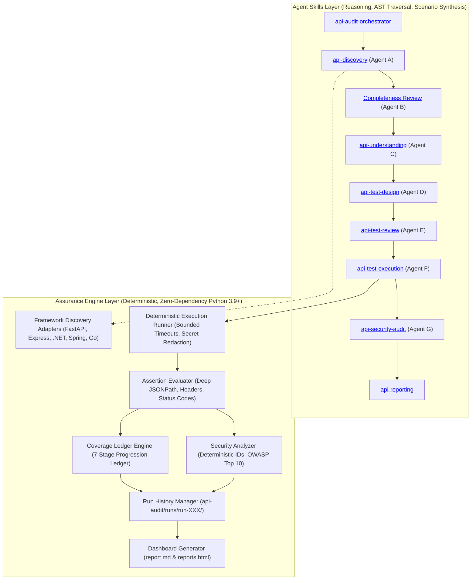

# Universal API Assurance (UAA)

[](https://www.python.org/)
[](LICENSE)
[-success.svg)](engine/)
[](schemas/finding.schema.json)
[](docs/coverage-model.md)
[](docs/execution-safety.md)

**Universal API Assurance (UAA)** is an enterprise-grade, autonomous, framework-agnostic, and protocol-independent API assurance ecosystem. It unifies **6-layer source discovery**, **semantic code understanding**, **adversarial test design**, **zero-dependency deterministic execution**, **automated OWASP security auditing**, and **continuous multi-run regression tracking** into an evidence-backed verification pipeline.

Unlike conventional test tools that rely on superficial endpoint signatures or generative AI that hallucinates test outcomes, UAA establishes a **strict architectural firewall**: autonomous AI agents analyze and design tests, while a zero-dependency, deterministic Python runtime executes requests, redacts secrets, and computes mathematical verification ledgers.

---

## Table of Contents

- <a href="#the-paradigm-shift">The Paradigm Shift</a>
- <a href="#core-architectural-pillars">Core Architectural Pillars</a>
- <a href="#system-architecture">System Architecture</a>
- <a href="#agent-skills-layer">Agent Skills Layer</a>
  - <a href="#skill-orchestration--adversarial-review-protocol">Multi-Agent Adversarial Protocol</a>
  - <a href="#skill-directory--reference-guide">Skill Directory & References</a>
- <a href="#how-anyone-can-use-uaa">How Anyone Can Use UAA</a>
  - <a href="#path-a-using-uaa-with-ai-coding-agents">Path A: Using UAA with AI Coding Agents</a>
  - <a href="#path-b-using-uaa-as-a-standalone-cli--engine">Path B: Using UAA as a Standalone CLI & Engine</a>
- <a href="#end-to-end-quickstart-tutorial">End-to-End Quickstart Tutorial</a>
- <a href="#the-7-stage-measurable-coverage-ledger">The 7-Stage Measurable Coverage Ledger</a>
- <a href="#automated-owasp-api-security-auditing">Automated OWASP API Security Auditing</a>
- <a href="#multi-run-history--regression-tracking">Multi-Run History & Regression Tracking</a>
- <a href="#cli-command-reference">CLI Command Reference</a>
- <a href="#ci-cd-pipeline-integration">CI/CD Pipeline Integration</a>
- <a href="#canonical-schemas--artifacts">Canonical Schemas & Artifacts</a>
- <a href="#repository-layout">Repository Layout</a>
- <a href="#contributing--license">Contributing & License</a>

---

<a id="the-paradigm-shift"></a>
## The Paradigm Shift

| Metric / Dimension | Traditional API Testing (Postman / RestAssured) | Generative AI Test Tools | Universal API Assurance (UAA) |
|---|---|---|---|
| **Discovery Scope** | Manual authoring; only tests what engineers remember to specify. | Scrapes public Swagger/OpenAPI docs or single router files. | **6-Layer Reconciliation**: Contracts, route decorators, AST traversal, plugin mounts, runtime reflection, and gateway manifests. |
| **Code Understanding** | None. Blind black-box probes. | Superficial text summaries from route headers. | **Deep Semantic Tracing**: Middleware pipelines, authn/authz policies, DTO validation rules, tenant isolation, and persistence side effects. |
| **Pass / Fail Decision** | Deterministic, but brittle and manual. | Generative model inspects response and "decides" if it passed. | **Deterministic Engine**: Standard library runner evaluates strictly typed JSONPath, HTTP status, and header invariants. |
| **Coverage Claims** | Blind percentage of manually written test files. | Misleading "100% of discovered endpoints tested" vanity claims. | **7-Stage Measurable Ledger**: Quantifies Discovered $\to$ Understood $\to$ Designed $\to$ Executed $\to$ Asserted $\to$ Verified, with audited reasons for untested routes. |
| **Security Auditing** | Separate heavyweight DAST scans run out-of-band. | Generic prompt asking LLM to "find bugs". | **Deterministic OWASP Analyzers**: Grounded static inspection + runtime execution evidence for BOLA, Mass Assignment, Auth Bypass, and Data Leaks. |
| **Historical Drift** | Overwrites previous test runs; regressions discovered manually. | No run-to-run persistence or historical memory. | **Immutable Run Archives**: Automatic `run-001` $\to$ `run-002` differential analysis flagging regressions, fixes, and endpoint drift. |

---

<a id="core-architectural-pillars"></a>
## Core Architectural Pillars

1. **Zero External Runtime Dependencies**: The entire execution, assertion, ledger, security analysis, and reporting engine is built exclusively on the **Python 3.9+ standard library** (`urllib.request`, `json`, `hashlib`, `argparse`, `unittest`). No `pip install` required, no third-party package vulnerabilities, and immediate portability across air-gapped CI/CD environments.
2. **Deterministic Execution Firewall**: The AI is strictly an analyst and test designer. It **never** evaluates pass/fail verdicts or executes raw shell commands. All network transactions, retries, secret redactions, response bounding (2MB cap), and assertion checks are handled by the deterministic runner.
3. **Multi-Agent Adversarial Verification**: To prevent hallucinations and blind spots, UAA employs peer agents with competing objectives (e.g., Agent A discovers routes; Agent B independently inspects ASTs to catch shadowed or missing endpoints; Agent D designs tests; Agent E attacks the test suite for missing boundary conditions).
4. **Non-Production Safety Invariants**: By default, UAA operates in **read-only discovery mode**. Execution against a live server requires an explicit user-approved `--base-url`. Destructive mutations (`DELETE`, bulk modifications) and external side-effects (payment gateways, transactional emails, SMS triggers) are automatically flagged and disabled unless explicitly unlocked.
5. **Secret Redaction by Design**: Credentials and secrets are never committed into JSON test specifications. They are referenced via `${ENV_VAR}` variables, resolved at runtime, and scrubbed from all artifact logs, markdown summaries, and HTML dashboards.

---

<a id="system-architecture"></a>
## System Architecture

UAA enforces a decoupled two-tier architecture:



---

<a id="agent-skills-layer"></a>
## Agent Skills Layer

The `skills/` directory encapsulates specialized, role-bounded agent operational capabilities. Each skill is packaged with a canonical `SKILL.md` instruction file and reference documentation.

<a id="skill-orchestration--adversarial-review-protocol"></a>
### Multi-Agent Adversarial Review Protocol

To guarantee uncompromising quality, UAA orchestrates distinct agent roles that challenge each other:

- **Agent A (Primary Discovery)** scans contracts, routes, and source files to compile the initial endpoint inventory.
- **Agent B (Adversarial Completeness Reviewer)** independently checks ASTs, regex tables, and configuration manifests to find shadowed, dynamically mounted, or uninspected routes.
- **Agent C (Code Understander)** traces the request lifecycle from entry middleware down to persistence models, recording authorization schemes, side-effect risks, and validation schemas.
- **Agent D (Test Designer)** generates deterministic test specifications across 10 functional and negative categories.
- **Agent E (Adversarial Test Reviewer)** challenges Agent D's scenarios: checks for missing edge cases (e.g., zero/negative values, tenant leakage), ensures no ungrounded assertions exist, and verifies destructive operation tags.
- **Agent F (Deterministic Runner)** invokes the execution engine against the approved non-production target.
- **Agent G (Security & Assurance Auditor)** evaluates static and runtime OWASP vulnerabilities, updates the coverage ledger, and builds historical regression reports.

<a id="skill-directory--reference-guide"></a>
### Skill Directory & References

Click any skill below to view its complete operational contract:

| Skill | Role | Primary Responsibility | Documentation & References |
|---|---|---|---|
| <a>**`api-audit-orchestrator`**</a> | Lifecycle Lead | Orchestrates the 5-phase audit lifecycle, enforces safety gates, manages multi-run history, and coordinates agent handoffs. | <a href="skills/api-audit-orchestrator/SKILL.md">`skills/api-audit-orchestrator/SKILL.md`</a> |
| <a>**`api-discovery`**</a> | Agent A | Performs multi-source route discovery across contracts, frameworks, ASTs, and gateways; reconciles discrepancies. | <a href="skills/api-discovery/SKILL.md">`skills/api-discovery/SKILL.md`</a><br>&bull; <a href="skills/api-discovery/references/discovery-layers.md">Discovery Layers Guide</a> |
| <a>**`api-understanding`**</a> | Agent C | Traces request-to-response lifecycles, authentication schemes, input validation models, and persistence side effects. | <a href="skills/api-understanding/SKILL.md">`skills/api-understanding/SKILL.md`</a><br>&bull; <a href="skills/api-understanding/references/request-tracing.md">Request Tracing Guide</a> |
| <a>**`api-test-design`**</a> | Agent D | Synthesizes deterministic test scenarios with typed assertions, auth profiles, and safety risk classifications. | <a href="skills/api-test-design/SKILL.md">`skills/api-test-design/SKILL.md`</a><br>&bull; <a href="skills/api-test-design/references/scenario-patterns.md">Scenario Patterns Guide</a> |
| <a>**`api-test-review`**</a> | Agent E | Adversarially reviews test scenarios; enforces negative edge cases, schema grounding, and destructive safety controls. | <a href="skills/api-test-review/SKILL.md">`skills/api-test-review/SKILL.md`</a> |
| <a>**`api-security-audit`**</a> | Agent G | Evaluates OWASP API Top 10 vulnerabilities (BOLA, broken auth, mass assignment, leaks) with deterministic IDs. | <a href="skills/api-security-audit/SKILL.md">`skills/api-security-audit/SKILL.md`</a><br>&bull; <a href="skills/api-security-audit/references/owasp-api-top10.md">OWASP API Top 10 Guide</a> |
| <a>**`api-test-execution`**</a> | Agent F | Enforces safety gates, resolves `${ENV_VAR}` secrets, and runs sequential tests using the zero-dependency runner. | <a href="skills/api-test-execution/SKILL.md">`skills/api-test-execution/SKILL.md`</a> |
| <a>**`api-reporting`**</a> | Reporting Agent | Calculates the 7-stage coverage ledger, compiles markdown reports, and renders the interactive HTML dashboard. | <a href="skills/api-reporting/SKILL.md">`skills/api-reporting/SKILL.md`</a> |

---

<a id="how-anyone-can-use-uaa"></a>
## How Anyone Can Use UAA

You can use UAA through two primary modalities:
1. **<a href="#path-a-using-uaa-with-ai-coding-agents">Path A: With AI Coding Assistants (Antigravity, Claude Code, Cursor, Copilot)</a>** for end-to-end autonomous discovery, test synthesis, and auditing.
2. **<a href="#path-b-using-uaa-as-a-standalone-cli--engine">Path B: As a Standalone CLI & CI/CD Pipeline</a>** for deterministic test execution, security scans, coverage ledger generation, and regression tracking without needing an LLM.

---

<a id="path-a-using-uaa-with-ai-coding-agents"></a>
### Path A: Using UAA with AI Coding Agents

When working with an AI coding assistant, UAA acts as an expert autonomous pair-programmer. The root <a href="SKILL.md">`SKILL.md`</a> and modular skills in <a href="skills/">`skills/`</a> guide the agent through a safe, five-phase protocol:

#### 1. Activate the Skill
In your AI assistant prompt, instruct the agent to run an audit:
```text
Run an API assurance audit on this repository using the UAA skills.
First perform discovery and understanding, and stop at the execution safety gate.
```

#### 2. Phase 0 & 1 — Discovery & Completeness Check
- The agent scans for OpenAPI contracts, ASP.NET Core / FastAPI / Express route definitions, and gateway manifests.
- It generates `api-audit/endpoint-inventory.json` and human-readable `api-audit/endpoint-inventory.md`.
- Agent B performs an adversarial completeness review to ensure no shadowed routes were missed.

#### 3. Phase 2 & 3 — Understanding & Scenario Design
- The agent traces entry middleware, JWT/session authentication, DTO validation, and database side effects.
- It synthesizes deterministic test scenarios into `api-audit/testspecifications.json`.
- Agent E conducts an adversarial review to ensure boundary values, negative authentication, and tenant isolation tests are present.

#### 4. Phase 4 — Execution Gate Approval
The agent **must pause** and prompt you for approval before making network calls:
> *"I have discovered 18 endpoints and designed 42 test scenarios (38 read-only, 4 destructive). Please approve the non-production base URL (e.g. `http://localhost:8000`) and specify whether destructive operations are permitted."*

#### 5. Phase 5 — Deterministic Execution & Dashboards
Once approved, the agent executes the suite using the standard library engine and presents you with the standalone `reports.html` dashboard and markdown summary.

---

<a id="path-b-using-uaa-as-a-standalone-cli--engine"></a>
### Path B: Using UAA as a Standalone CLI & Engine

You don't need an active LLM to execute tests, enforce schemas, calculate coverage ledgers, or compare historical runs. The core assurance engine runs directly with Python:

```bash
# Clone the repository
git clone https://github.com/universal-api-assurance/uaa.git
cd uaa

# Verify all engine unit and integration tests (zero dependencies!)
python -m unittest discover tests
```

#### Step 1: Validate Artifacts Against Canonical JSON Schemas
Ensure that hand-authored or CI-generated inventories and test specs strictly adhere to UAA's Draft 2020-12 schemas:
```bash
python -m engine.cli validate inventory --file examples/basic-rest/endpoint-inventory.json
python -m engine.cli validate testspec --file examples/basic-rest/testspecifications.json
python -m engine.cli validate ledger --file examples/basic-rest/coverage-ledger.json
```

#### Step 2: Deterministically Execute Test Specifications
Run test scenarios sequentially against a running target with strict timeout bounds, secret redaction, and no automatic redirect following:
```bash
API_BEARER_TOKEN="test-token-xyz" python -m engine.cli execute \
  --spec examples/basic-rest/testspecifications.json \
  --base-url http://127.0.0.1:8000 \
  --out-dir api-audit/runs/run-001/ \
  --timeout 10.0
```

#### Step 3: Compute the 7-Stage Measurable Coverage Ledger
Reconcile your discovered endpoint inventory with actual execution results to calculate your verified coverage ratio:
```bash
python -m engine.cli coverage \
  --inventory examples/basic-rest/endpoint-inventory.json \
  --results api-audit/runs/run-001/execution-results.json \
  --out-dir api-audit/runs/run-001/
```

#### Step 4: Run Automated OWASP Security Rules
Evaluate your inventory and execution results for unauthenticated sensitive routes, BOLA/IDOR indicators, mass assignment risks, credential leakage, and missing security headers:
```bash
python -m engine.cli security-check \
  --inventory examples/basic-rest/endpoint-inventory.json \
  --results api-audit/runs/run-001/execution-results.json \
  --out-dir api-audit/runs/run-001/
```

#### Step 5: Render Markdown Reports and Interactive HTML Dashboards
Generate a comprehensive executive audit report (`report.md`) and a standalone interactive HTML dashboard (`reports.html`):
```bash
python -m engine.cli report --run-dir api-audit/runs/run-001/
```

#### Step 6: Multi-Run Historical Regression Tracking
When running subsequent audits (e.g., in a CI pipeline or after bug fixes), compare sequential runs to detect regressions, verified fixes, and coverage loss:
```bash
python -m engine.cli history-compare \
  --runs-dir api-audit \
  --prev run-001 \
  --curr run-002 \
  --out-file api-audit/runs/run-002/trend.json
```

---

<a id="end-to-end-quickstart-tutorial"></a>
## End-to-End Quickstart Tutorial

Test UAA in under two minutes using the bundled `examples/basic-rest/` fixtures:

```bash
# 1. Verify environment
python -c "import sys; assert sys.version_info >= (3, 9), 'Python 3.9+ required'"

# 2. Inspect the sample inventory and test specifications
cat examples/basic-rest/endpoint-inventory.json
cat examples/basic-rest/testspecifications.json

# 3. Run the automated security analysis on the sample inventory
python -m engine.cli security-check \
  --inventory examples/basic-rest/endpoint-inventory.json \
  --out-dir test-audit/

# 4. Inspect the generated deterministic security findings
cat test-audit/findings.md
```

You will see deterministic security findings like:
- `FIND-AUTH-XXXX`: Flagging unauthenticated sensitive routes (`DELETE /api/v1/users/{id}`)
- `FIND-BOLA-XXXX`: Flagging parameterized object paths lacking tenant isolation
- `FIND-MASS-XXXX`: Flagging request schemas accepting privileged attributes (`role`, `is_admin`)

---

<a id="the-7-stage-measurable-coverage-ledger"></a>
## The 7-Stage Measurable Coverage Ledger

Traditional QA vanity metrics claim "100% of discovered endpoints tested" even when destructive endpoints were skipped and authentication was never verified.

UAA replaces vanity metrics with an **audited, mathematical progression ledger**:

```text
[Discovered] ──> [Understood] ──> [Designed] ──> [Executed] ──> [Asserted] ──> [Verified]
                                                                                     │
                                                                           (Untested Surface)
                                                                                     │
                                                                           [Explicit Reason Logged]
```

### The Verification Lifecycle Stages:
1. **Discovered**: Confirmed through contracts, framework decorators, AST parsing, or gateways. Anchored to source file and line range.
2. **Understood**: Route parameters, query filters, auth schemes, and side-effect risks mapped in `endpoint-inventory.json`.
3. **Scenarios Designed**: Deterministic test cases created in `testspecifications.json`.
4. **Executed**: HTTP requests dispatched to the approved non-production target.
5. **Asserted**: Status code, headers, Content-Type, and deep JSONPath assertions evaluated.
6. **Verified**: Endpoints achieved passing assertions on core scenarios without unhandled exceptions.
7. **Unverified Accounting**: If an endpoint cannot be verified, it carries a mandatory reason code:
   - `destructive_action_disallowed`: Deletes or permanent modifications disabled for safety.
   - `external_effect_disallowed`: Endpoint triggers real payment, email, or third-party webhooks.
   - `missing_credentials`: Required authentication secret was not provided in the environment.
   - `unresolved_parameter_values`: Dynamic entity ID requires prerequisite fixtures.

$$\text{Verified Coverage Ratio} = \frac{\text{Verified Passing Endpoints}}{\text{Total Discovered Endpoints}} \times 100\%$$

---

<a id="automated-owasp-api-security-auditing"></a>
## Automated OWASP API Security Auditing

The security analyzer (<a href="skills/api-security-audit/SKILL.md">`api-security-audit`</a> & `engine/security/rules.py`) continuously scans endpoint inventories and runtime execution traces against the **OWASP API Security Top 10**:

| Vulnerability Category | OWASP API Top 10 | Detection Mechanism | Severity | Deterministic Finding ID |
|---|---|---|---|---|
| **Broken Object Level Authorization** | API1:2023 | Parameterized paths (`/users/{id}`) lacking documented tenant isolation metadata. | High | `FIND-BOLA-XXXX` |
| **Broken Authentication** | API2:2023 | Sensitive routes (`DELETE`, `/admin/*`, `/billing/*`) declared with `required: false`. | High | `FIND-AUTH-XXXX` |
| **Broken Object Property Level Authorization** | API3:2023 | Runtime detection of leaked credentials (`password_hash`, `secret_key`, `private_key`). | Critical | `FIND-LEAK-XXXX` |
| **Server-Side Request Forgery / Mass Assignment** | API6:2023 | Request schemas accepting privileged client properties (`role`, `is_admin`, `balance`). | Medium | `FIND-MASS-XXXX` |
| **Security Misconfiguration** | API8:2023 | Internal stack traces leaked in 500 responses (`traceback`, `NullReferenceException`). | Medium | `FIND-ERR-XXXX` |
| **Security Misconfiguration** | API8:2023 | Missing defense-in-depth headers (`X-Content-Type-Options: nosniff`, `X-Frame-Options`). | Low | `FIND-HDR-XXXX` |

All finding IDs are generated deterministically via SHA-256 digests (`FIND-<TYPE>-XXXX`), guaranteeing stable references across historical runs.

---

<a id="multi-run-history--regression-tracking"></a>
## Multi-Run History & Regression Tracking

Audit runs are stored immutably in sequential directories:
```text
api-audit/
└── runs/
    ├── run-001/    # Baseline run
    ├── run-002/    # Post-refactor run
    └── run-003/    # Pre-deployment validation
```

The <a href="skills/api-reporting/SKILL.md">`RunHistoryManager`</a> provides comprehensive delta analysis:
- **Status Regressions**: Scenarios that previously passed but now fail.
- **Coverage Loss**: Scenarios that existed previously but are now missing from the test run.
- **New Failures**: Newly introduced test scenarios that failed.
- **Verified Fixes**: Scenarios that previously failed but now pass.
- **Pass Rate Delta**: Exact mathematical variance between runs.

---

<a id="cli-command-reference"></a>
## CLI Command Reference

The unified command line interface (`python -m engine.cli`) provides the following subcommands:

### `validate`
Validate any UAA artifact against its canonical JSON Schema (Draft 2020-12):
```bash
python -m engine.cli validate [inventory|testspec|execution|ledger] --file <path>
```

### `execute`
Deterministically execute a test specification file:
```bash
python -m engine.cli execute \
  --spec <path-to-testspec.json> \
  --base-url <http://target-url> \
  [--out-dir <output-dir>] \
  [--run-id <custom-run-id>] \
  [--timeout <seconds>] \
  [--allow-destructive]
```

### `coverage`
Build the 7-stage measurable coverage ledger from inventory and execution artifacts:
```bash
python -m engine.cli coverage \
  --inventory <path-to-endpoint-inventory.json> \
  --results <path-to-execution-results.json> \
  [--out-dir <output-dir>]
```

### `security-check`
Run static and dynamic security rules to produce `findings.json` and `findings.md`:
```bash
python -m engine.cli security-check \
  --inventory <path-to-endpoint-inventory.json> \
  [--results <path-to-execution-results.json>] \
  [--out-dir <output-dir>]
```

### `report`
Synthesize all run artifacts into a Markdown report and standalone interactive HTML dashboard:
```bash
python -m engine.cli report --run-dir <path-to-run-dir>
```

### `history-compare`
Compare two sequential runs for regressions, fixes, and coverage loss:
```bash
python -m engine.cli history-compare \
  --runs-dir <api-audit-dir> \
  --prev <run-001> \
  --curr <run-002> \
  [--out-file <output-trend.json>]
```

---

<a id="ci-cd-pipeline-integration"></a>
## CI/CD Pipeline Integration

Embed UAA directly into your continuous integration workflow. Because UAA has zero external dependencies, setup is instantaneous.

### GitHub Actions Workflow (`.github/workflows/api-assurance.yml`)

```yaml
name: API Assurance Audit

on:
  push:
    branches: [main, master]
  pull_request:
    branches: [main, master]

jobs:
  audit:
    runs-on: ubuntu-latest
    steps:
      - name: Checkout Code
        uses: actions/checkout@v4

      - name: Set up Python
        uses: actions/setup-python@v5
        with:
          python-version: "3.11"

      - name: Run Engine Tests
        run: python -m unittest discover tests

      - name: Start Non-Production API Mock / Test Server
        run: |
          # Start your test container, mock server, or staging app
          python -m http.server 8000 &
          sleep 2

      - name: Execute API Assurance Suite
        env:
          TEST_API_TOKEN: ${{ secrets.TEST_API_TOKEN }}
        run: |
          python -m engine.cli execute \
            --spec examples/basic-rest/testspecifications.json \
            --base-url http://127.0.0.1:8000 \
            --out-dir api-audit/runs/run-ci/

      - name: Calculate Coverage Ledger & Security Findings
        run: |
          python -m engine.cli coverage \
            --inventory examples/basic-rest/endpoint-inventory.json \
            --results api-audit/runs/run-ci/execution-results.json \
            --out-dir api-audit/runs/run-ci/

          python -m engine.cli security-check \
            --inventory examples/basic-rest/endpoint-inventory.json \
            --results api-audit/runs/run-ci/execution-results.json \
            --out-dir api-audit/runs/run-ci/

          python -m engine.cli report --run-dir api-audit/runs/run-ci/

      - name: Upload Audit Dashboard Artifacts
        uses: actions/upload-artifact@v4
        with:
          name: api-assurance-report
          path: |
            api-audit/runs/run-ci/report.md
            api-audit/runs/run-ci/reports.html
            api-audit/runs/run-ci/findings.json
            api-audit/runs/run-ci/coverage-ledger.json
```

---

<a id="canonical-schemas--artifacts"></a>
## Canonical Schemas & Artifacts

All UAA artifacts are validated against JSON Schemas conforming to **JSON Schema Draft 2020-12**:

| Artifact Filename | Canonical Schema | Purpose |
|---|---|---|
| `endpoint-inventory.json` | <a href="schemas/inventory.schema.json">`schemas/inventory.schema.json`</a> | Normalized endpoint catalog with HTTP methods, path templates, auth requirements, and source anchors. |
| `testspecifications.json` | <a href="schemas/testspec.schema.json">`schemas/testspec.schema.json`</a> | Deterministic test specifications with request parameters, typed assertions, and safety tags. |
| `execution-results.json` | <a href="schemas/execution.schema.json">`schemas/execution.schema.json`</a> | Raw execution outcomes, response status codes, latencies, evaluated assertions, and redacted payloads. |
| `coverage-ledger.json` | <a href="schemas/coverage-ledger.schema.json">`schemas/coverage-ledger.schema.json`</a> | 7-stage verification progression ledger tracking verified passing routes and unverified reasons. |
| `findings.json` | <a href="schemas/finding.schema.json">`schemas/finding.schema.json`</a> | Structured OWASP API Top 10 vulnerabilities with severity badges, evidence claims, and remediation diffs. |
| `report.md` | Built-in | Markdown executive audit summary suitable for pull request comments or security review notes. |
| `reports.html` | Built-in | Self-contained, single-file interactive dashboard featuring Overview, Endpoint Explorer, Test Explorer, Security Findings, Failure Analysis, and Trends. |

---

<a id="repository-layout"></a>
## Repository Layout

```text
universal-api-assurance/
├── README.md                          # Production guide and documentation portal
├── SKILL.md                           # Master orchestration skill for AI coding agents
├── LICENSE                            # MIT License
│
├── skills/                            # Agent Skills Layer (Reasoning & Orchestration)
│   ├── api-audit-orchestrator/        # End-to-end lifecycle and review coordinator
│   ├── api-discovery/                 # 6-layer endpoint discovery & reconciliation
│   │   └── references/discovery-layers.md
│   ├── api-understanding/             # Request-to-persistence semantic flow tracer
│   │   └── references/request-tracing.md
│   ├── api-test-design/               # Deterministic test scenario synthesis
│   │   └── references/scenario-patterns.md
│   ├── api-test-review/               # Adversarial test reviewer (Agent E)
│   ├── api-security-audit/            # OWASP API Top 10 vulnerability scanner
│   │   └── references/owasp-api-top10.md
│   ├── api-test-execution/            # Bounded sequential runner coordinator
│   └── api-reporting/                 # Coverage ledger & interactive HTML dashboard builder
│
├── engine/                            # Zero-Dependency Assurance Engine (Python 3.9+)
│   ├── cli.py                         # Unified UAA CLI interface
│   ├── assertions/                    # Deep JSONPath, header, and status code evaluators
│   ├── coverage/                      # 7-stage measurable coverage ledger engine
│   ├── evidence/                      # Provenance tracker and evidence models
│   ├── execution/                     # Deterministic HTTP runner and secret redactor
│   ├── reporting/                     # Markdown and HTML report generation & history manager
│   ├── security/                      # OWASP rule analyzers with deterministic IDs
│   └── specification/                 # Canonical models and builders
│
├── schemas/                           # Formal JSON Schemas (Draft 2020-12)
│   ├── endpoint.schema.json
│   ├── inventory.schema.json
│   ├── testspec.schema.json
│   ├── execution.schema.json
│   ├── finding.schema.json
│   └── coverage-ledger.schema.json
│
├── validators/                        # Schema and artifact verification tooling
│   ├── schema_validator.py
│   ├── validate_inventory.py
│   ├── validate_testspec.py
│   ├── validate_execution.py
│   └── validate_report.py
│
├── adapters/                          # Framework and Protocol Adapters
│   ├── discovery/                     # FastAPI, Express, .NET, Spring, Go AST analyzers
│   └── protocols/                     # HTTP, GraphQL, gRPC, WebSocket runners
│
├── docs/                              # In-Depth Architectural Documentation
│   ├── architecture.md                # System topology and layer boundaries
│   ├── coverage-model.md              # 7-stage mathematical verification ledger
│   ├── execution-safety.md            # Non-production execution safety invariants
│   ├── evidence-model.md              # Evidence provenance and claim validation
│   └── extension-guide.md             # Guide for authoring custom discovery & security rules
│
├── examples/                          # Reference Audit Artifacts & Fixtures
│   ├── basic-rest/                    # Standard REST API reference audit artifacts
│   ├── multi-tenant-api/              # Multi-tenant BOLA/IDOR reference audit artifacts
│   └── graphql-api/                   # GraphQL query/mutation audit artifacts
│
└── tests/                             # Test Suite (Standard Library unittest)
    ├── unit/                          # Engine unit tests (models, assertions, security)
    ├── integration/                   # Multi-run history and execution runner tests
    ├── compatibility/                 # Framework adapter compatibility tests
    └── end_to_end/                    # Full audit lifecycle pipeline tests
```

---

<a id="contributing--license"></a>
## Contributing & License

Universal API Assurance is open source under the **MIT License**. See the [LICENSE](LICENSE) file for complete details.

Contributions are welcome! Please ensure:
1. All engine code uses only the **Python standard library** (no external runtime dependencies).
2. All changes include comprehensive unit/integration tests running under `python -m unittest discover tests`.
3. Any updates to JSON artifacts validate cleanly against the corresponding schemas in `schemas/`.
