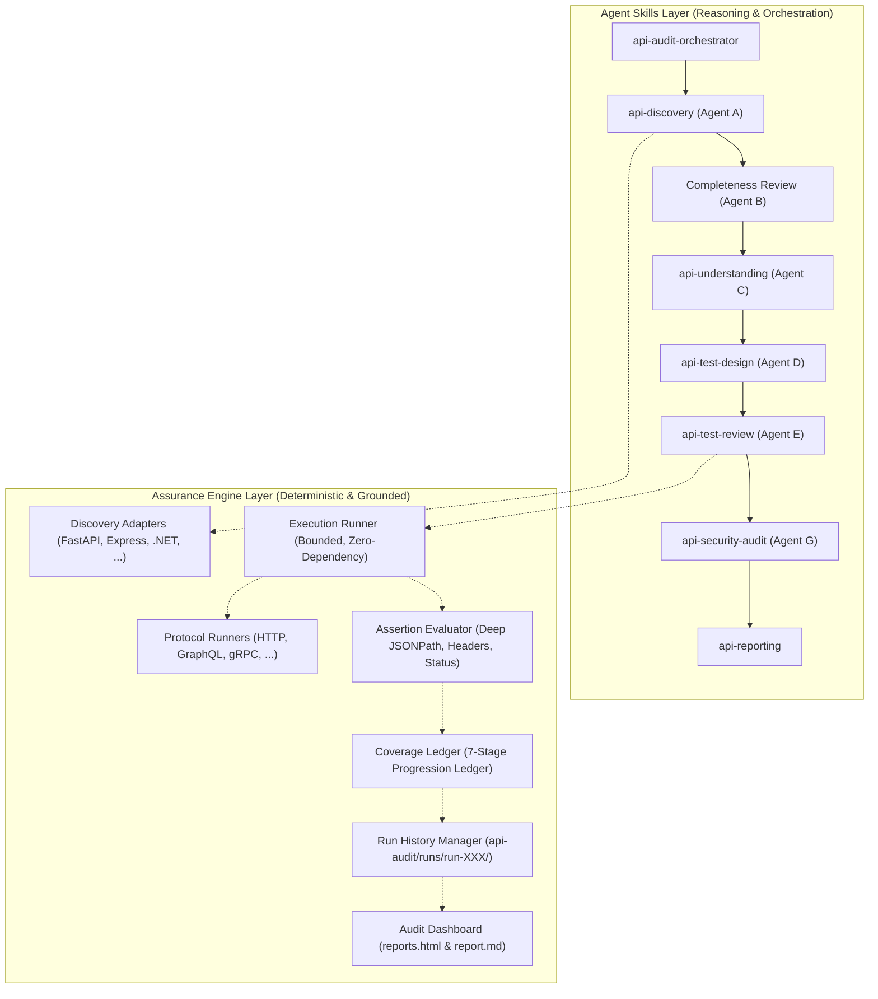

# Universal API Assurance (UAA) - System Architecture

Universal API Assurance (UAA) is an autonomous, framework-agnostic, and protocol-independent API discovery, understanding, security audit, deterministic testing, and evidence-based assurance ecosystem.



## 1. Core Architectural Separation

UAA strictly separates two operational layers:

### A. Agent Skills Layer
Responsible for autonomous reasoning, semantic code understanding, AST traversal, scenario synthesis, adversarial multi-agent reviews, and lifecycle orchestration.
- **Agent A (`api-discovery`)**: Traverses source code and contracts across 6 discovery layers.
- **Agent B (`completeness review`)**: Adversarially challenges Agent A's inventory to find shadowed or overlooked routes.
- **Agent C (`api-understanding`)**: Traces data validation, authentication schemes, and domain side effects.
- **Agent D (`api-test-design`)**: Synthesizes deterministic test scenarios with explicit assertions.
- **Agent E (`api-test-review`)**: Adversarially checks Agent D's scenarios for missing edge cases and safety tags.
- **Agent F (`api-test-execution`)**: Invokes the deterministic runner against verified non-production targets.
- **Agent G (`api-security-audit` & `api-reporting`)**: Evaluates OWASP API Top 10 vulnerabilities, compiles the measurable coverage ledger, and compiles multi-run regression dashboards.

### B. Assurance Engine Layer
Responsible for zero-dependency, deterministic execution, cryptographic redaction, assertion evaluation, historical run storage, and schema validation.
- **Zero External Dependencies**: Core engine and runner execute cleanly using Python 3.9+ standard library.
- **AI Independence**: Test execution and pass/fail verdicts are deterministic; AI never decides pass/fail.

---

## 2. 6-Layer Discovery Strategy

Endpoints are discovered and reconciled across 6 hierarchical layers:
1. **Layer 1: Official API Contracts**: OpenAPI, Swagger, AsyncAPI, GraphQL SDL, Protobuf definitions.
2. **Layer 2: Framework Route Registration**: Controller attributes (`[HttpGet]`), route decorators (`@app.get()`), router declarations (`router.get()`).
3. **Layer 3: Source Code AST Analysis**: Path concatenation, router mounting prefixes (`/api/v1`), middleware pipelines.
4. **Layer 4: Dependency & Plugin Registration**: Plugin modules, dynamic CRUD route generators.
5. **Layer 5: Runtime Route Metadata**: Non-destructive framework inspection when safe.
6. **Layer 6: Deployment & Gateway Configuration**: Nginx, Kong, Kubernetes Ingress, Envoy, AWS API Gateway manifests.

---

## 3. Measurable Coverage Ledger Model

A simple count of passed tests is insufficient for API assurance. UAA models verification through an explicit 7-stage ledger:
1. `Discovered`: Identified in at least one source layer.
2. `Understood`: Parameters, auth requirements, and side effects documented.
3. `Scenarios Designed`: Deterministic test specifications synthesized.
4. `Executed`: Scenarios executed against target origin.
5. `Asserted`: HTTP status, headers, and JSON body assertions evaluated.
6. `Verified`: At least one core scenario passed without unhandled failures.
7. `Gaps Accounted For`: Unverified endpoints carry an explicit, audited reason (e.g. `destructive_action_disallowed`, `missing_credentials`).

---

## 4. Multi-Run Historical Integrity

Every audit execution is stored in an immutable, timestamped directory:
```text
api-audit/
└── runs/
    ├── run-001/
    │   ├── endpoint-inventory.json
    │   ├── testspecifications.json
    │   ├── execution-results.json
    │   ├── coverage-ledger.json
    │   ├── findings.json
    │   ├── report.md
    │   └── reports.html
    ├── run-002/
    └── run-003/
```
Subsequent runs automatically compare results against prior runs to detect:
- **Regressions**: Scenarios that previously passed but now fail.
- **Fixes**: Scenarios that previously failed but now pass.
- **Endpoint Drift**: Endpoints newly introduced or removed from source code.

